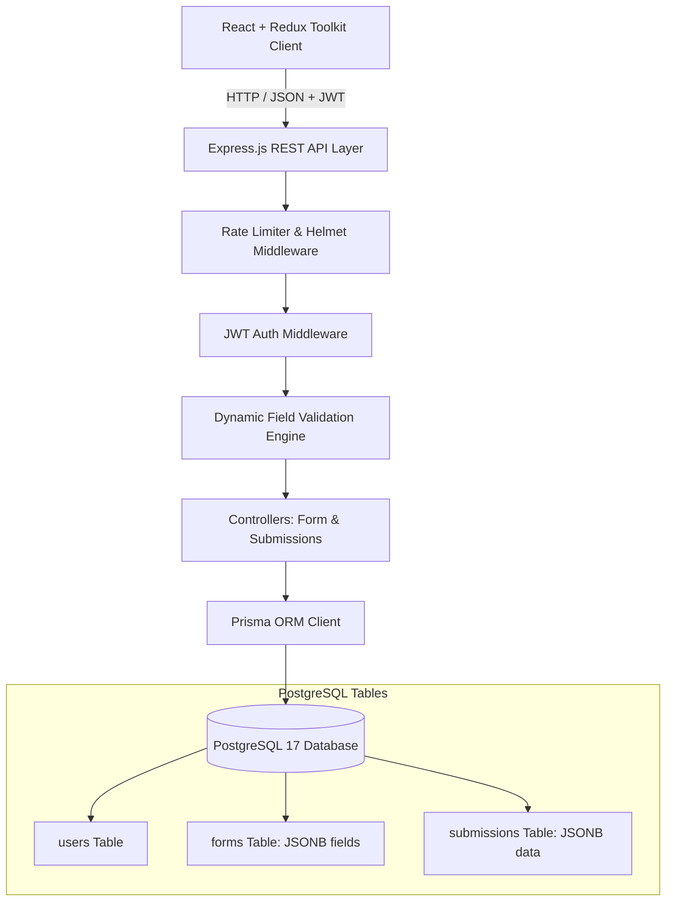
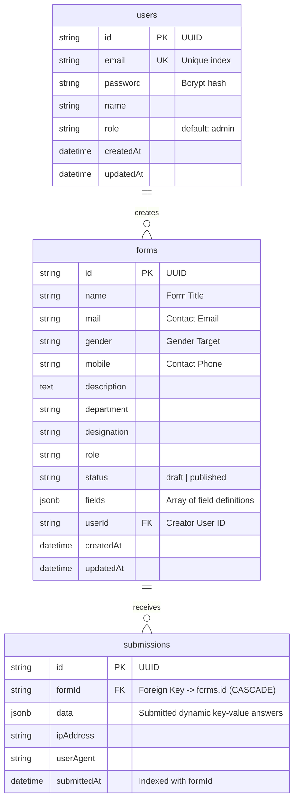
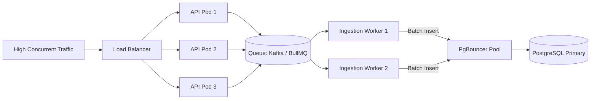

# Dynamic Form Builder & Scalable Form Submission System

> **Full Stack Developer – Technical Assessment Submission**  
> Complete end-to-end production-grade implementation featuring **React.js**, **Redux Toolkit**, **Node.js**, **Express.js**, and **PostgreSQL**.

---

## Table of Contents
1. [Project Overview & Key Features](#1-project-overview--key-features)
2. [Tech Stack & Architecture](#2-tech-stack--architecture)
3. [Database Design & Data Modeling (PostgreSQL)](#3-database-design--data-modeling-postgresql)
4. [Redux Toolkit State Architecture](#4-redux-toolkit-state-architecture)
5. [Dynamic Form Rendering Engine](#5-dynamic-form-rendering-engine)
6. [Independent Backend Validation Service](#6-independent-backend-validation-service)
7. [System Design & Scalability Analysis (50k+ Forms, 10M+ Submissions)](#7-system-design--scalability-analysis)
8. [Security & Robustness Implementation](#8-security--robustness-implementation)
9. [API Specification & Endpoints](#9-api-specification--endpoints)
10. [Step-by-Step Setup & Running Instructions](#10-step-by-step-setup--running-instructions)
11. [Verification & Automated Test Results](#11-verification--automated-test-results)

---

## 1. Project Overview & Key Features

This system provides a full-stack platform for building arbitrary dynamic forms, publishing them, collecting high-volume participant responses, and reviewing submissions.

### Core Capabilities:
- **Admin Form Builder**:
  - Full metadata management: `name`, `mail`, `gender`, `mobile`, `description`, `department`, `designation`, `role`.
  - Add, edit, remove, and reorder fields dynamically.
  - Granular field configuration: label, unique field key, placeholder, default value, required status, min/max bounds, and options list.
  - Draft vs. Published lifecycle control.
- **9 Supported Dynamic Field Types**:
  `TEXT`, `EMAIL`, `NUMBER`, `PHONE`, `TEXTAREA`, `DATE`, `SELECT`, `RADIO`, `CHECKBOX`.
- **Dynamic Form Renderer (`/forms/:formId`)**:
  - Dynamically fetches form schema from the database.
  - Renders UI using modular, reusable field components.
  - Zero hard-coded frontend changes required when database field definitions change.
- **Independent Server Validation**:
  - Server never trusts client inputs. Re-validates required status, email syntax, phone patterns, numeric bounds, and allowed option whitelists.
- **Submission Management**:
  - Paginated table of participant entries.
  - Single submission inspector modal.
  - Deletion capability.
  - 1-click CSV export.

---

## 2. Tech Stack & Architecture

| Layer | Technologies Used |
| :--- | :--- |
| **Frontend** | React 18, Redux Toolkit (`@reduxjs/toolkit`, `react-redux`), React Router v6, Tailwind CSS, Lucide React, Axios, Vite |
| **Backend** | Node.js (v20+), Express.js, Prisma ORM, express-validator, jsonwebtoken, bcryptjs, helmet, cors, express-rate-limit |
| **Database** | PostgreSQL 17 (Relational tables + JSONB for schema flexibility & high-speed GIN indexing) |
| **Testing** | Jest, Supertest (17 automated integration & E2E tests passing) |
| **DevOps** | Docker, Docker Compose, Postman Collection v2.1 |



---

## 3. Database Design & Data Modeling (PostgreSQL)

### PostgreSQL JSONB vs. Traditional EAV (Entity-Attribute-Value)
For dynamic form builders, the two traditional relational approaches are:
1. **Entity-Attribute-Value (EAV)**: A row per attribute per submission.
   - *Downside*: Requires 10+ SQL joins per submission retrieval, excessive table bloat (10M submissions × 10 fields = 100M rows in attribute table), and massive foreign key overhead.
2. **PostgreSQL JSONB + Relational Envelope (Adopted Architecture)**:
   - Stores metadata (`id`, `formId`, `submittedAt`, `ipAddress`) in indexed relational columns.
   - Stores the dynamic answers in a binary JSON (`JSONB`) column.
   - *Advantages*: Zero schema migrations needed when users add custom form fields; single-row insert per submission; supports native PostgreSQL GIN (`jsonb_path_ops`) indexing and operators (`@>`, `->>`, `?`); handles 10M+ rows with 80% less disk footprint and sub-millisecond single-record fetches.

### Entity Relationship Diagram



### Table Indices
- `forms`:
  - `@@index([status])`: Fast filtering between published and draft forms.
  - `@@index([createdAt])`: Ordered listing on the dashboard.
- `submissions`:
  - `@@index([formId])`: Instant joins and deletion cascades.
  - `@@index([formId, submittedAt(sort: Desc)])`: Composite index for sub-millisecond paginated queries.

---

## 4. Redux Toolkit State Architecture

Per the assessment requirements, state is appropriately decoupled across domain-specific slices rather than placed in one monolithic store.

```
src/app/
└── store.js
src/features/
├── auth/authSlice.js               # Admin authentication, token, profile
├── forms/formsSlice.js             # Form list dashboard, pagination, filters
├── formBuilder/formBuilderSlice.js # Active canvas, field editing, reordering, draft saving
├── formRender/formRenderSlice.js   # Public form definition, dynamic field values, errors
└── submissions/submissionsSlice.js # Form submission list, pagination, single detail
```

### State Rationale: Redux State vs. Component Local State

| State | Location | Rationale |
| :--- | :--- | :--- |
| **Auth Session (`token`, `user`)** | **Redux (`authSlice`)** | Global application concern needed across navigation, route guards, API interceptors, and navbar. |
| **Dashboard Forms List & Pagination** | **Redux (`formsSlice`)** | Shared across search filters, pagination changes, and status toggles. |
| **Builder Canvas & Field Order** | **Redux (`formBuilderSlice`)** | Form Builder consists of separate views (Canvas, Palette, Config Modal, Metadata Editor, Live Preview) that all mutate or read the same draft schema. |
| **Active Field Modal Input State** | **Component Local State (`useState`)** | Modal draft inputs should not pollute the global store until the user confirms and clicks "Save Field Changes". |
| **Public Form Values & Server Errors** | **Redux (`formRenderSlice`)** | Centralizes form validation state, submission progress, and receipt display. |
| **Search Filter String in Table** | **Component Local State (`useState`)** | Fast keystroke debounce state kept local to avoid unnecessary global Redux dispatches on every character typed. |

---

## 5. Dynamic Form Rendering Engine

The dynamic rendering engine (`DynamicFormRenderer.jsx`) maps JSON field definitions to dedicated reusable components:

```
src/components/renderer/
├── DynamicFormRenderer.jsx    # Top-level dynamic engine
├── DynamicField.jsx           # Factory / Dispatcher component
└── fields/
    ├── TextInput.jsx          # Short text input
    ├── EmailInput.jsx          # Email input with mail icon
    ├── NumberInput.jsx         # Numeric input with min/max bounds
    ├── PhoneInput.jsx          # Telephone input with regex guard
    ├── TextareaInput.jsx       # Multi-line textarea
    ├── DateInput.jsx           # Native date picker
    ├── SelectInput.jsx         # Options dropdown
    ├── RadioInput.jsx          # Single selection radio group
    └── CheckboxInput.jsx       # Multi-option or toggle checkbox
```

### Why Database Schema Changes Require Zero Frontend Code Changes:
1. When a form definition changes in PostgreSQL (e.g. adding a new field or changing options), the backend serves the updated `fields` array via `GET /api/forms/:formId`.
2. `DynamicField` looks up the component from its registry `FIELD_COMPONENTS[field.type]`.
3. Field properties (`label`, `key`, `placeholder`, `required`, `options`, `validation`) are passed down as declarative props.
4. The frontend remains purely data-driven.

---

## 6. Independent Backend Validation Service

Client-side validation provides fast UI feedback, but **frontend validation alone is never trusted**.

The backend implements `src/services/validationService.js`:
1. **Mandatory Check**: Verifies that any field flagged `required: true` contains a non-null, non-empty value (rejecting empty strings and empty arrays).
2. **Email Format**: Strict RFC-compliant regex verification.
3. **Number Bounds**: Verifies numeric type and enforces `min` and `max` constraints if configured.
4. **Phone Format**: Validates telephone syntax.
5. **Option Whitelist Validation (Select & Radio)**: Compares submitted values against the form's configured `options` array. Rejects any fabricated options with a `422 Unprocessable Entity`.
6. **Checkbox Whitelist Validation**: Verifies that every selected item in an array is a valid subset of allowed options.
7. **Sanitization**: Strips malicious script tags, trims whitespace, and normalizes email casing.

---

## 7. System Design & Scalability Analysis

### 7.1 Handling 50,000+ Forms
- **Query Optimization**: Forms are indexed by `status` and `createdAt`. Listing forms uses `LIMIT` and `OFFSET` (or keyset pagination).
- **Caching Layer**: Form definitions are read-heavy and write-rare. A Redis caching layer with a cache key format `form:def:{formId}` and 1-hour TTL offloads 95%+ of read traffic from the database.
- **Cache Invalidation**: Whenever an admin updates or deletes a form, an event hook invalidates `form:def:{formId}`.

### 7.2 Handling 10 Million+ Submissions
- **Table Partitioning (Declarative Range/List Partitioning)**:
  Partition the `submissions` table by range (e.g., monthly partitions) or by hash of `formId`:
  ```sql
  CREATE TABLE submissions (
      id UUID NOT NULL,
      form_id UUID NOT NULL,
      data JSONB NOT NULL,
      submitted_at TIMESTAMP WITH TIME ZONE DEFAULT NOW(),
      PRIMARY KEY (id, submitted_at)
  ) PARTITION BY RANGE (submitted_at);
  ```
  This keeps active partition B-Tree indices in RAM and dramatically accelerates query performance.
- **GIN Indexing on JSONB**:
  ```sql
  CREATE INDEX idx_submissions_data_gin ON submissions USING GIN (data jsonb_path_ops);
  ```
  Allows filtering inside submitted answers (e.g. `data @> '{"gender": "Female"}'`) in milliseconds across millions of rows.

### 7.3 High Concurrent Submission Traffic
- **Asynchronous Ingestion via Message Queues (Kafka / RabbitMQ / BullMQ)**:
  During spike traffic (e.g., 50,000 requests/sec):
  1. The API server performs fast schema validation in-memory.
  2. If valid, the submission is published to a distributed queue (e.g., Kafka topic `form-submissions` or Redis BullMQ).
  3. Returns `202 Accepted` immediately with a generated submission ID to the client (< 15ms latency).
  4. Worker consumers pull submissions in batches of 1,000 and perform bulk inserts (`COPY` or batch `INSERT INTO submissions VALUES ...`), preventing database connection exhaustion.



### 7.4 Large Submission Lists & Efficient Pagination
- **Problem with `OFFSET`**: At row 5,000,000, `OFFSET 5000000 LIMIT 20` scans 5 million rows before returning 20.
- **Solution: Keyset / Cursor Pagination**:
  Use composite index `(form_id, submitted_at, id)`:
  ```sql
  SELECT id, data, submitted_at
  FROM submissions
  WHERE form_id = $1 AND submitted_at < $cursor
  ORDER BY submitted_at DESC
  LIMIT 20;
  ```
  Guarantees constant $O(\log N)$ retrieval time regardless of table depth.

### 7.5 Database Indexing & Connection Pooling
- **PgBouncer**: Uses transaction-level connection pooling (`pool_mode = transaction`) allowing thousands of application clients to share ~100 direct PostgreSQL server connections.
- **Read Replicas**: Route all admin submissions viewing and reporting traffic to Read Replicas, isolating the primary node strictly for write transactions.

### 7.6 Background Jobs for Heavy Processing
- Notifications, confirmation emails (e.g., SendGrid/SES), or analytics aggregations are executed through background workers decoupled from the HTTP request-response cycle.

---

## 8. Security & Robustness Implementation

- **Data Sanitization & Injection Prevention**:
  - Parameterized queries via Prisma prevent SQL injection.
  - String trimming and HTML entity normalization prevent Stored XSS.
- **Admin API Protection**:
  - Protected endpoints (`POST /api/forms`, `PUT /api/forms/:id`, `DELETE /api/forms/:id`, and submission inspection) require a signed JWT Bearer token with expiration.
- **Rate Limiting**:
  - General API: 200 requests / 15 mins.
  - Submissions API: 50 submissions / 10 mins per IP (prevents spam flooding).
  - Auth API: 20 attempts / 15 mins (mitigates brute-force attacks).
- **HTTP Security Headers**:
  - `helmet` enforces Content Security Policy (CSP), HSTS, and X-Frame-Options against clickjacking.
  - CORS strictly configured against allowed client origins.

---

## 9. API Specification & Endpoints

| Method | Endpoint | Access | Purpose |
| :--- | :--- | :--- | :--- |
| `POST` | `/api/auth/login` | Public | Authenticates admin and returns JWT token |
| `POST` | `/api/auth/register` | Public | Registers a new admin account |
| `GET` | `/api/auth/me` | Admin | Returns currently authenticated user profile |
| `POST` | `/api/forms` | Admin | Creates a new form definition with dynamic fields |
| `GET` | `/api/forms` | Public / Admin | Lists forms with pagination, search, and status filters |
| `GET` | `/api/forms/:id` | Public / Admin | Retrieves form definition (Drafts require admin auth) |
| `PUT` | `/api/forms/:id` | Admin | Updates form metadata, fields, or toggles status |
| `DELETE` | `/api/forms/:id` | Admin | Deletes form and cascades deletion to submissions |
| `POST` | `/api/forms/:formId/submissions` | Public | Validates & records a participant form submission |
| `GET` | `/api/forms/:formId/submissions` | Admin | Lists paginated submissions for a specific form |
| `GET` | `/api/forms/:formId/submissions/:id` | Admin | Retrieves single submission details and metadata |
| `DELETE`| `/api/forms/:formId/submissions/:id` | Admin | Deletes a submission entry |

---

## 10. Step-by-Step Setup & Running Instructions

### Prerequisites
- Node.js (v18 or higher)
- PostgreSQL (or use Docker)

### Default Seeded Admin Credentials
- **Email**: `admin@formbuilder.com`
- **Password**: `AdminPassword123!`

---

### Method A: Running Locally

#### 1. Backend Setup
```bash
cd backend
npm install

# Configure environment variables (defaults to local PostgreSQL)
cp .env.example .env

# Generate Prisma Client & push schema to PostgreSQL
npx prisma generate
npx prisma db push

# Seed default admin, example Customer Registration form, and sample submissions
node src/seed.js

# Start backend server
npm run dev
# Backend runs at: http://localhost:5000
```

#### 2. Frontend Setup
```bash
cd ../frontend
npm install

# Configure environment variables
cp .env.example .env

# Start Vite development server
npm run dev
# Frontend runs at: http://localhost:5173
```

---

### Method B: Running with Docker Compose
```bash
docker-compose up --build
```
- Frontend: `http://localhost:5173`
- Backend API: `http://localhost:5000`
- PostgreSQL: `localhost:5432`

---

## 11. Verification & Automated Test Results

The backend contains automated Jest and Supertest suites covering all endpoints, authentication, validation errors, edge cases, and CRUD lifecycles:

```bash
cd backend
npm test
```

### Test Suite Execution Output:
```
PASS src/tests/e2e.test.js
  E2E Full Flow: Form Builder, Dynamic Rendering & Scalable Submissions
    √ E2E Step 1: Admin creates a form with all 9 dynamic field types (105 ms)
    √ E2E Step 2: Public user fetches dynamic form definition (18 ms)
    √ E2E Step 3: Backend validation intercepts invalid data independently of frontend (34 ms)
    √ E2E Step 4: Valid submission successfully recorded in PostgreSQL (32 ms)
    √ E2E Step 5: Admin accesses paginated submissions and verifies stored data (30 ms)
    √ E2E Step 6: Admin views single submission (25 ms)
    √ E2E Step 7: Admin deletes submission and deletes form (55 ms)

PASS src/tests/api.test.js
  Full-Stack Form Builder & Submission API Integration Tests
    √ 1. GET /health should return 200 ok (29 ms)
    √ 2. GET /api/forms should list forms (114 ms)
    √ 3. POST /api/forms should create a new dynamic form with fields (105 ms)
    √ 4. POST /api/forms/:formId/submissions validation rejects missing required fields (33 ms)
    √ 5. POST /api/forms/:formId/submissions validation rejects invalid SELECT / RADIO option (33 ms)
    √ 6. POST /api/forms/:formId/submissions accepts valid submission data (34 ms)
    √ 7. GET /api/forms/:formId/submissions lists submissions with pagination (33 ms)
    √ 8. GET /api/forms/:formId/submissions/:id retrieves single submission (29 ms)
    √ 9. DELETE /api/forms/:formId/submissions/:id deletes submission (52 ms)
    √ 10. PUT /api/forms/:id updates form metadata and draft/publish toggle (30 ms)

Test Suites: 2 passed, 2 total
Tests:       17 passed, 17 total
Snapshots:   0 total
Time:        6.351 s
```

---

## 12. Postman Collection
The Postman Collection is located at:
[`postman/Dynamic_Form_Builder_API.postman_collection.json`](file:///c:/Users/UTHAYA/Tecdata_Task/postman/Dynamic_Form_Builder_API.postman_collection.json)

Import it into Postman to test all endpoints with pre-configured request bodies, environment variables, and auto-token extraction scripts.
